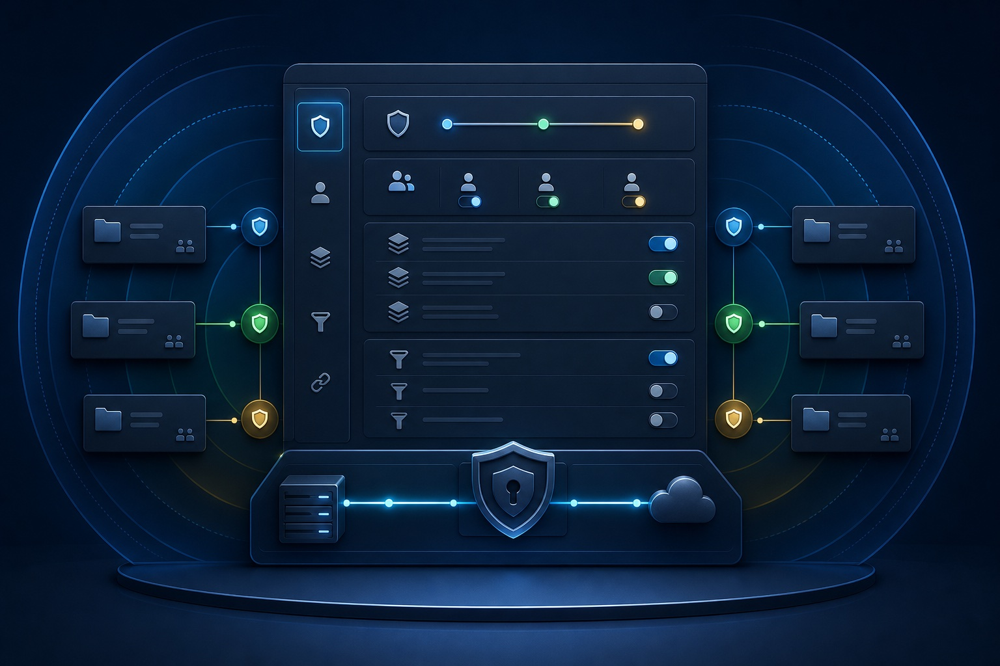

# Configuration

    <!-- markdownlint-disable-line MD013 -->

Your client config (`.mcp.json`, `.codex/config.toml`, `.vscode/mcp.json`,
`.cursor/mcp.json`, or `claude_desktop_config.json`) contains your API token.
Treat it like a password. This repo gitignores `.mcp.json`, but when you place a
project-scoped config in your **own** project, add both it and its timestamped
backups (e.g. `.mcp.json.bak*`) to that project's `.gitignore` so the token is
never committed — choose your client-specific guide from [Clients](clients.md)
for the exact file and command.

**Never share your API token** in chat messages, screenshots, or log output. If
a token has been exposed, revoke it immediately in **My account → Access
tokens** and create a new one.

## Wizard modes

`openproject-ce-mcp configure` writes a minimal config: only the values you set
differ from a safe default, so a fresh setup is just `OPENPROJECT_BASE_URL` and
`OPENPROJECT_API_TOKEN` plus the tool profile (always written) and whatever
scope you gave it — not a fully-spelled-out file (see the tables below for what every field defaults to).
Three flags control what it does; see [Clients](clients.md) for the
global-vs-project-scoped question every mode asks first:

- **`configure` / `configure --quick`** (the default) — client target(s), base
  URL, token, readable projects, the [tool profile](#tool-profile), and (if write access is enabled) a Y/N per
  project-scoped write category (work packages, projects, memberships,
  versions, boards, meetings), mapped directly to the matching
  `OPENPROJECT_ENABLE_*_WRITE` flag. These prompts do not touch personal-data
  writes (`OPENPROJECT_ENABLE_PERSONAL_WRITE`), admin writes
  (`OPENPROJECT_ENABLE_ADMIN_WRITE`) or user-schedule writes
  (`OPENPROJECT_ENABLE_USER_SCHEDULE_WRITE`); those are independent and keep
  whatever value they already had (off, on a fresh setup). Use `--advanced` to
  change them.
- **`configure --advanced`** runs the full questionnaire: every tool group's read
  and write controls (including personal-data, admin and user-schedule writes),
  field filtering, and runtime settings, in addition to the quick-mode
  questions. Reconfiguring an existing setup with `--quick` leaves
  any advanced-only values you'd previously set untouched.
- **`configure --uninstall`** — removes the `openproject` entry from client
  configs instead of writing one; see [Installation](installation.md#uninstall).

Before writing anything, the wizard tests the connection against your real
OpenProject instance and shows a preview of every change (files to create,
update, or remove; the effective settings) — nothing is written or removed until
you confirm. This is keyed on **stdin alone** being a real terminal, so
redirecting stdout (e.g. `configure | tee log`) does not skip it — a human
typing answers always gets the connection test and confirmation. Ctrl+C cancels
cleanly at any point without writing. Only a genuinely non-interactive stdin
(piped canned answers, CI, install scripts) or the explicit `--non-interactive`
flag skips the connection test and preview and writes directly.

## Connection

| Variable | Required | Default | Description |
| --- | --- | --- | --- |
| `OPENPROJECT_BASE_URL` | yes | — | Base URL of your OpenProject instance, e.g. `https://op.example.com` |
| `OPENPROJECT_API_TOKEN` | yes | — | Personal API token |

## Project Scope

| Variable | Required | Default | Description |
| --- | --- | --- | --- |
| `OPENPROJECT_READ_PROJECTS` | no | empty (nothing readable) | Readable projects; comma-separated project identifiers, numeric ids, or glob patterns (e.g. `my-project,team-*`); `*` allows all visible projects; empty or unset denies all project-scoped reads |
| `OPENPROJECT_WRITE_PROJECTS` | no | empty (nothing writable) | Writable projects; empty or unset disables all project-scoped writes; always intersected with read scope — so `*` here writes-enables every project that `OPENPROJECT_READ_PROJECTS` also allows, not every project on the instance regardless of read scope |

A pattern matches a project's numeric id or its current identifier, never its
name: a name is free text that any project admin can change and that is not
unique. A pattern may hold letters, digits, `-` and `_` and the wildcards `*`,
`?` and `[abc]`; any other pattern (a name with spaces, for example) stops the
server at start with a configuration error. Passing a former identifier to a
tool does not make a renamed project match: OpenProject 17.3 and later still
finds the project by it, but the check uses the project's current values.

Content such as a list of work packages links its project by id only.
When either list matches a linked project by its identifier alone, the server
reads the project's current identifier before it checks the response, one
request per project and response.

A project created after the server started (a copy, the web UI, another client)
is matched as soon as a response shows or links it; no restart is needed.
`list_work_packages` without a `project` filters on the readable projects the
server has seen and refreshes that list at most every five minutes, so a new
project's work packages can take up to five minutes to appear there unless
another call has already shown the project. Before each such list it reads every
project in that filter that a pattern does not match by id, one request per page
of projects, and leaves out any that no longer matches, so the counts and sums
OpenProject returns cover only readable projects. Archived projects are left out
of that filter, since OpenProject hides their work packages.

## Tool Profile

| Variable | Required | Default | Description |
| --- | --- | --- | --- |
| `OPENPROJECT_TOOL_PROFILE` | no | `full` | `full` registers every tool the settings below allow. `core` registers only a compact starter set of 21 tools (projects, work packages, relations, time entries, the reference lists, your own account) for small models and short contexts. Any other value stops the server at start. |

A profile only narrows. A tool is registered only when its group switch, the
project allowlists and the write flags select it, and the profile then keeps
it or drops it; it never registers a tool those settings leave out, and every
write still needs `confirm=true`. With `core` and both project lists set to `*`
exactly these tools register: `list_projects`, `get_project`,
`get_current_user`, `list_work_packages`, `search_work_packages`,
`list_my_open_work_packages`, `get_work_package`,
`list_work_package_activities`, `list_work_package_relations`, `list_statuses`,
`list_types`, `list_priorities`, `list_available_assignees`, `list_versions`,
`create_work_package`, `update_work_package`, `add_work_package_comment`,
`create_work_package_relation`, `delete_relation`, `create_time_entry`,
`list_time_entries`. The six starter writes need a non-empty
`OPENPROJECT_WRITE_PROJECTS`; with only `OPENPROJECT_READ_PROJECTS` set `core`
registers 15 tools, with neither list set 4. Meetings, boards and every other
group are not part of `core`: switch to `full` to use them, and trim `full`
with the group switches below.

`configure` asks for the profile and writes it into the config. A fresh setup
is offered `core`; an existing setup without the key keeps `full`, and the
answer is written out so that a later default change cannot narrow it.
`openproject-ce-mcp doctor` shows the number of tools the profile registers and
the number `full` would register. A tool that is missing under `core` is
outside the profile, not broken.

## Tool Groups

Each tool group below has its own `OPENPROJECT_ENABLE_<GROUP>_READ`
boolean controlling whether that group's tools are registered at all — this
governs tool *visibility* (and context-token budget), not data access; the
actual security boundary is `OPENPROJECT_READ_PROJECTS` /
`OPENPROJECT_WRITE_PROJECTS` plus the write flags below.

The default groups (projects, work packages, memberships, versions, boards,
meetings) default `true`. Their project-bound read tools are registered only
while `OPENPROJECT_READ_PROJECTS` is non-empty, regardless of
`OPENPROJECT_WRITE_PROJECTS`, so with `OPENPROJECT_READ_PROJECTS` empty (the
default) only their project-independent read tools are registered, listed
under [Tools per switch](#tools-per-switch).
`OPENPROJECT_ENABLE_PERSONAL_READ`, `OPENPROJECT_ENABLE_ADMIN_READ`,
`OPENPROJECT_ENABLE_USER_SCHEDULE_READ` and `OPENPROJECT_ENABLE_EXTENDED_READ`
default `false`; they are opt-in because they surface data with a different
exposure than the default groups: `personal` your own
preferences/notifications, `admin` the instance-wide user/group list (names,
logins, emails) via `list_users`/`get_user`/`list_groups`/`get_group`/
`list_principals`, `user_schedule` per-user vacations and working hours, and
`extended` rarely-needed metadata and reference tools. Apart from the
project-bound tools of these groups listed below, none of that is bounded by a
project scope the way the default groups are, so it stays out of the tool set
until explicitly requested.

| Variable | Required | Default | Description |
| --- | --- | --- | --- |
| `OPENPROJECT_ENABLE_PROJECT_READ` | no | `true` | Projects and their context, sprints, backlog buckets, documents, project storages (a project's link to a configured external file storage), news, wiki pages, forum posts, views, grids, categories, phases, instance configuration, background jobs |
| `OPENPROJECT_ENABLE_WORK_PACKAGE_READ` | no | `true` | Work packages, search, activities, reactions, reminders, relations, attachments, file links, watchers, statuses, priorities, types, time entries, costs, GitHub and GitLab links, wiki links, saved queries |
| `OPENPROJECT_ENABLE_MEMBERSHIP_READ` | no | `true` | Project memberships, roles, current user, actions, capabilities |
| `OPENPROJECT_ENABLE_VERSION_READ` | no | `true` | Versions |
| `OPENPROJECT_ENABLE_BOARD_READ` | no | `true` | Boards |
| `OPENPROJECT_ENABLE_MEETING_READ` | no | `true` | Meetings, agenda items, sections, outcomes, recurring meetings and their occurrences |
| `OPENPROJECT_ENABLE_PERSONAL_READ` | no | `false` | Your own preferences and notifications |
| `OPENPROJECT_ENABLE_ADMIN_READ` | no | `false` | Instance-wide user/group listing plus external file storage connections; PII / admin-only, not project-scoped. `list_project_storages`/`get_project_storage` are not gated here; they are project-scoped, see `OPENPROJECT_ENABLE_PROJECT_READ` |
| `OPENPROJECT_ENABLE_USER_SCHEDULE_READ` | no | `false` | Per-user schedule overrides: vacation date ranges and working-hours schedules (requires OpenProject 17.3+). Its own dedicated scope: not bounded by a project allowlist, but also not `_ADMIN_READ` (would block ordinary self-service) or `_PERSONAL_READ` (its tools take no `user_id`) |
| `OPENPROJECT_ENABLE_EXTENDED_READ` | no | `false` | Rarely-used metadata/reference tools: query schemas, text rendering, custom options, help texts, working days, project budgets |

Each write flag below requires its matching read boolean to be `true` — e.g.
`OPENPROJECT_ENABLE_BOARD_WRITE=true` with `OPENPROJECT_ENABLE_BOARD_READ=false`
fails at startup with a clear error. The project-scoped write flags (the default
groups' writes) default `true`, since the real gate for them is the project allowlists above (a write
flag alone does nothing without a project in `OPENPROJECT_WRITE_PROJECTS`, and
the corresponding write tools aren't even registered unless both
`OPENPROJECT_READ_PROJECTS` and `OPENPROJECT_WRITE_PROJECTS` are non-empty); set
one to `false` to carve out an exception once you've granted write access.
`OPENPROJECT_ENABLE_PERSONAL_WRITE`, `OPENPROJECT_ENABLE_ADMIN_WRITE` and
`OPENPROJECT_ENABLE_USER_SCHEDULE_WRITE` default `false`; none is bounded by a
project allowlist, so there is no equivalent safety net for them.

| Variable | Required | Default | Description |
| --- | --- | --- | --- |
| `OPENPROJECT_ENABLE_PROJECT_WRITE` | no | `true` | Project create/update/delete/copy and favorites, news, documents, grids. Has no effect without a non-empty `OPENPROJECT_WRITE_PROJECTS` |
| `OPENPROJECT_ENABLE_WORK_PACKAGE_WRITE` | no | `true` | Work-package create/update/delete including subtasks and bulk writes, comments, reactions, reminders, relations, attachments, watchers, time entries, file links, wiki links, starring saved queries. Has no effect without a non-empty `OPENPROJECT_WRITE_PROJECTS` |
| `OPENPROJECT_ENABLE_MEMBERSHIP_WRITE` | no | `true` | Project membership create/update/delete. Has no effect without a non-empty `OPENPROJECT_WRITE_PROJECTS` |
| `OPENPROJECT_ENABLE_VERSION_WRITE` | no | `true` | Version create/update/delete. Has no effect without a non-empty `OPENPROJECT_WRITE_PROJECTS` |
| `OPENPROJECT_ENABLE_BOARD_WRITE` | no | `true` | Board create/update/delete. Has no effect without a non-empty `OPENPROJECT_WRITE_PROJECTS` |
| `OPENPROJECT_ENABLE_MEETING_WRITE` | no | `true` | Meeting/agenda-item/section/outcome/recurring-meeting create/update/delete, recurring meeting occurrences. Has no effect without a non-empty `OPENPROJECT_WRITE_PROJECTS` |
| `OPENPROJECT_ENABLE_PERSONAL_WRITE` | no | `false` | Personal-data mutations (update your own preferences, mark notifications read). Personal read tools require only `OPENPROJECT_ENABLE_PERSONAL_READ=true`; personal mutations require both the read and write flags together |
| `OPENPROJECT_ENABLE_USER_SCHEDULE_WRITE` | no | `false` | Create/update/delete a user's non-working times and working-hours schedule (requires `OPENPROJECT_ENABLE_USER_SCHEDULE_READ=true` too, like every other write flag requires its matching read) |

`OPENPROJECT_ENABLE_ADMIN_WRITE` is documented under [Security /
Privacy](#security--privacy) below.

### Tools per switch

Each switch registers the tools in its row, unless the project allowlists
above or the table after it keep a tool unregistered. While
`OPENPROJECT_READ_PROJECTS` is empty, the read switches of the default groups
register only these project-independent tools:
`list_project_phase_definitions`, `get_project_phase_definition`,
`get_instance_configuration`, `list_statuses`, `list_priorities`,
`list_types`, `get_cost_type`,
`get_github_pull_request`, `list_roles`, `get_current_user`, `list_actions`.
The project-scoped write switches register their tools only while both
`OPENPROJECT_READ_PROJECTS` and `OPENPROJECT_WRITE_PROJECTS` are non-empty.
The personal, admin, user-schedule and extended switches register their tools
regardless of either allowlist, except the project-bound tools of the extended
and personal groups (`list_project_budgets`, `list_version_projects`,
`list_work_package_available_watchers`, `list_work_package_available_projects`,
`list_work_package_revisions`, `get_notification`), which are registered only
while `OPENPROJECT_READ_PROJECTS` is non-empty; the further switches a tool
needs are listed below. A tool listed under several switches is
registered by any one of them. `render_text` is refused at call time unless
`OPENPROJECT_READ_PROJECTS` is `*` and no field of the records its macros name
is hidden.

| Switch | Tools |
| --- | --- |
| `OPENPROJECT_ENABLE_PROJECT_READ` | `list_projects`, `get_project`, `get_project_admin_context`, `get_project_configuration`, `list_sprints`, `get_sprint`, `list_backlog_buckets`, `get_backlog_bucket`, `list_documents`, `get_document`, `list_project_storages`, `get_project_storage`, `list_news`, `get_news`, `get_wiki_page`, `get_post`, `list_views`, `get_view`, `list_grids`, `get_grid`, `list_categories`, `get_category`, `list_project_phase_definitions`, `get_project_phase_definition`, `get_project_phase`, `get_my_project_access`, `get_project_work_package_context`, `get_instance_configuration`, `get_job_status` |
| `OPENPROJECT_ENABLE_WORK_PACKAGE_READ` | `list_work_packages`, `search_work_packages`, `get_work_package`, `get_work_packages`, `list_my_open_work_packages`, `list_work_package_activities`, `list_work_package_reactions`, `list_reminders`, `list_work_package_relations`, `list_container_attachments`, `list_work_package_attachments`, `get_attachment`, `get_attachment_content`, `list_work_package_file_links`, `list_work_package_watchers`, `list_available_assignees`, `list_work_package_available_relation_candidates`, `list_statuses`, `list_priorities`, `list_types`, `list_time_entry_activities`, `list_time_entries`, `get_time_entry`, `get_cost_entry`, `list_work_package_cost_entries`, `get_work_package_costs_by_type`, `get_cost_type`, `get_github_pull_request`, `list_work_package_github_pull_requests`, `list_work_package_gitlab_issues`, `list_work_package_gitlab_merge_requests`, `list_relations`, `list_work_package_wiki_links`, `execute_query` |
| `OPENPROJECT_ENABLE_MEMBERSHIP_READ` | `list_project_memberships`, `get_membership`, `list_roles`, `get_current_user`, `list_actions`, `list_capabilities` |
| `OPENPROJECT_ENABLE_VERSION_READ` | `list_versions`, `get_version` |
| `OPENPROJECT_ENABLE_BOARD_READ` | `list_boards`, `get_board` |
| `OPENPROJECT_ENABLE_MEETING_READ` | `list_meetings`, `get_meeting`, `list_meeting_agenda_items`, `list_work_package_meeting_agenda_items`, `get_meeting_agenda_item`, `list_meeting_outcomes`, `get_meeting_outcome`, `list_meeting_sections`, `get_meeting_section`, `list_recurring_meetings`, `get_recurring_meeting`, `list_recurring_meeting_occurrences` |
| `OPENPROJECT_ENABLE_PERSONAL_READ` | `get_my_preferences`, `list_notifications`, `get_notification` |
| `OPENPROJECT_ENABLE_ADMIN_READ` | `list_principals`, `list_users`, `get_user`, `list_groups`, `get_group`, `list_storages`, `get_storage` |
| `OPENPROJECT_ENABLE_USER_SCHEDULE_READ` | `list_user_non_working_times`, `list_user_working_hours`, `get_user_working_hours` |
| `OPENPROJECT_ENABLE_EXTENDED_READ` | `get_query_filter`, `get_query_column`, `get_query_operator`, `get_query_sort_by`, `list_query_filter_instance_schemas`, `get_query_filter_instance_schema`, `render_text`, `list_help_texts`, `list_working_days`, `list_non_working_days`, `get_custom_option`, `list_project_budgets`, `list_version_projects`, `list_work_package_available_watchers`, `list_work_package_available_projects`, `list_work_package_revisions` |
| `OPENPROJECT_ENABLE_PROJECT_WRITE` | `create_project`, `update_project`, `delete_project`, `copy_project`, `set_project_favorite`, `create_news`, `update_news`, `delete_news`, `update_document`, `create_grid`, `update_grid`, `delete_grid`, `create_container_attachment` |
| `OPENPROJECT_ENABLE_WORK_PACKAGE_WRITE` | `create_work_package`, `create_subtask`, `update_work_package`, `bulk_create_work_packages`, `bulk_update_work_packages`, `delete_work_package`, `add_work_package_comment`, `update_work_package_comment`, `toggle_activity_emoji_reaction`, `create_work_package_reminder`, `update_reminder`, `delete_reminder`, `create_work_package_relation`, `delete_relation`, `delete_attachment`, `set_work_package_watcher`, `create_time_entry`, `update_time_entry`, `create_time_entry_until`, `update_time_entry_until`, `delete_time_entry`, `update_relation`, `delete_file_link`, `set_query_starred`, `create_work_package_wiki_link`, `delete_work_package_wiki_link`, `create_work_package_attachment`, `create_container_attachment` |
| `OPENPROJECT_ENABLE_MEMBERSHIP_WRITE` | `create_membership`, `update_membership`, `delete_membership` |
| `OPENPROJECT_ENABLE_VERSION_WRITE` | `create_version`, `update_version`, `delete_version` |
| `OPENPROJECT_ENABLE_BOARD_WRITE` | `create_board`, `update_board`, `delete_board` |
| `OPENPROJECT_ENABLE_MEETING_WRITE` | `create_meeting`, `update_meeting`, `delete_meeting`, `create_meeting_agenda_item`, `update_meeting_agenda_item`, `delete_meeting_agenda_item`, `create_meeting_outcome`, `update_meeting_outcome`, `delete_meeting_outcome`, `create_meeting_section`, `update_meeting_section`, `delete_meeting_section`, `create_recurring_meeting`, `update_recurring_meeting`, `delete_recurring_meeting`, `end_recurring_meeting`, `init_recurring_meeting_occurrence`, `cancel_recurring_meeting_occurrence`, `create_container_attachment` |
| `OPENPROJECT_ENABLE_PERSONAL_WRITE` | `update_my_preferences`, `mark_notifications_read`, `mark_notifications_unread` |
| `OPENPROJECT_ENABLE_ADMIN_WRITE` | `create_user`, `update_user`, `delete_user`, `set_user_locked`, `create_group`, `update_group`, `delete_group`, `create_storage`, `update_storage`, `delete_storage` |
| `OPENPROJECT_ENABLE_USER_SCHEDULE_WRITE` | `create_user_non_working_time`, `update_user_non_working_time`, `delete_user_non_working_time`, `create_user_working_hours`, `update_user_working_hours`, `delete_user_working_hours` |

A few tools also need a setting outside their own group. Each is registered
only when its own flag and every setting in its row are enabled (`true` for a
flag, a directory for `OPENPROJECT_ATTACHMENT_ROOT`):

| Tool | Also requires |
| --- | --- |
| `get_my_project_access` | `OPENPROJECT_ENABLE_MEMBERSHIP_READ` |
| `get_project_work_package_context` | `OPENPROJECT_ENABLE_WORK_PACKAGE_READ`, `OPENPROJECT_ENABLE_VERSION_READ` |
| `get_query_filter`, `get_query_column`, `get_query_operator`, `get_query_sort_by`, `list_query_filter_instance_schemas`, `get_query_filter_instance_schema` | `OPENPROJECT_ENABLE_BOARD_READ` |
| `render_text` | `OPENPROJECT_ENABLE_WORK_PACKAGE_READ` |
| `list_project_budgets` | `OPENPROJECT_ENABLE_PROJECT_READ` |
| `list_version_projects` | `OPENPROJECT_ENABLE_VERSION_READ`, `OPENPROJECT_ENABLE_PROJECT_READ` |
| `list_work_package_available_watchers` | `OPENPROJECT_ENABLE_WORK_PACKAGE_READ` |
| `list_work_package_available_projects` | `OPENPROJECT_ENABLE_WORK_PACKAGE_READ`, `OPENPROJECT_ENABLE_PROJECT_READ` |
| `list_work_package_revisions` | `OPENPROJECT_ENABLE_WORK_PACKAGE_READ` |
| `create_work_package_attachment`, `create_container_attachment` | `OPENPROJECT_ATTACHMENT_ROOT` |

### Exposure controls vs. real security boundaries

`OPENPROJECT_ENABLE_*_WRITE`, the project scope
(`OPENPROJECT_READ_PROJECTS`/`OPENPROJECT_WRITE_PROJECTS`), field hiding, and
the preview/confirm flow are real security boundaries when the agent talks to
OpenProject exclusively through this MCP's tools: they stop an agent's own
mistakes and prompt-injection attempts from turning into writes or reads the
operator didn't intend.

`OPENPROJECT_ENABLE_PERSONAL_READ`/`_EXTENDED_READ`/`_ADMIN_READ`/
`_USER_SCHEDULE_READ` are also runtime-enforced gates, not cosmetic toggles —
they genuinely control what data reaches the agent's context, `_ADMIN_READ` in
particular keeping the instance-wide user/group list (PII) out of context by
default. What none of these controls can do is stop someone who independently
holds the API token and network access to OpenProject — they can call the REST
API directly, bypassing this MCP entirely. That is the OpenProject
role/permission system's job, not this server's: combine both layers for real
defense in depth.

## Token / Context Budget

| Variable | Required | Default | Description |
| --- | --- | --- | --- |
| `OPENPROJECT_DEFAULT_PAGE_SIZE` | no | `10` | Default results per page (kept small to bound list context; raise if you want more rows per call). Must not exceed `OPENPROJECT_MAX_PAGE_SIZE` |
| `OPENPROJECT_MAX_PAGE_SIZE` | no | `50` | Hard cap on results per request. Must not exceed `OPENPROJECT_MAX_RESULTS`. At startup it is lowered, with a warning, to the maximum page size of the OpenProject API (Administration, API and webhooks) when that is smaller |
| `OPENPROJECT_MAX_RESULTS` | no | `100` | Hard cap on total results returned by a tool |
| `OPENPROJECT_TEXT_LIMIT` | no | `500` | Char cap for the description preview in list/search results (context protection across many rows), max `50000`. Single-item reads (`get_work_package`, `list_work_package_activities`) return full text regardless; a per-call `text_limit` overrides this |

## Security / Privacy

| Variable | Required | Default | Description |
| --- | --- | --- | --- |
| `OPENPROJECT_HIDE_<ENTITY>_FIELDS` | no | empty | Comma-separated fields to omit from reads and reject on writes for a given entity; `*` wildcards supported. See [Field hiding](field-hiding.md) for the full list of supported entities and the matching syntax — this variable exists once per entity, so it is not repeated here in full |
| `OPENPROJECT_HIDE_CUSTOM_FIELDS` | no | empty | Custom field names or keys to omit; `*` wildcards supported. Read/write asymmetry: on writes, a pattern matches either the raw key (`customField12`) or the field's friendly name; on reads (the `custom_fields`/`custom_comments` response fields), a pattern matches ONLY the raw key/wildcard — a friendly-name-only pattern hides nothing from reads. See [Field hiding](field-hiding.md#custom-fields-a-readwrite-asymmetry) for the full explanation |
| `OPENPROJECT_ATTACHMENT_ROOT` | no | disabled (no uploads) | Absolute directory that local attachment uploads are confined to. Unset/empty disables both `create_work_package_attachment` and `create_container_attachment` — there is no current-working-directory fallback. With the root set and usable project scope, work-package uploads require work-package writes; container uploads register when any of project, meeting or work-package writes is enabled. Files outside the configured root are refused, and credential/config files (`.mcp.json`, `.env`, `*.pem`, keys) are refused even inside it, so a tool call cannot exfiltrate local secrets |
| `OPENPROJECT_ATTACHMENT_CONTENT_MAX_BYTES` | no | `5242880` (5 MB) | Largest attachment content inlined into a tool response by `get_attachment_content`, and the aggregate budget for `list_work_package_attachments`' `include_images`. Enforced while streaming, so an oversized attachment is never fully downloaded. Hard ceiling `26214400` (25 MB); a per-call `max_bytes` may only lower this value, never raise it. Unrelated to OpenProject's own upload limit, which still bounds `create_work_package_attachment` |
| `OPENPROJECT_ENABLE_ADMIN_WRITE` | no | `false` | User and group management (create/update/delete/lock users, create/update/delete groups) plus external file storage connection management (create/update/delete storages). Must be set explicitly and is not activated by any project-scoped write flag. Creating a OneDrive/Sharepoint storage on a Community Edition instance is rejected by OpenProject itself with a validation error (Enterprise-only providers); Nextcloud is unrestricted |

## Network / Runtime

| Variable | Required | Default | Description |
| --- | --- | --- | --- |
| `OPENPROJECT_TIMEOUT` | no | `12` | Request timeout in seconds |
| `OPENPROJECT_VERIFY_SSL` | no | `true` | Verify TLS certificates. `false` turns verification off for an `https://` base URL and logs a startup warning naming the host; anyone on the network path can then read the API token. For an instance behind a private CA, keep this `true` and set `SSL_CERT_FILE` to the CA bundle instead; the HTTP client reads it. A plain `http://` base URL to a non-local host also logs a startup warning |
| `OPENPROJECT_MAX_RETRIES` | no | `3` | Retries for 429/5xx responses, max `10` |
| `OPENPROJECT_RETRY_BASE_DELAY` | no | `1.0` | Initial retry delay in seconds |
| `OPENPROJECT_RETRY_MAX_DELAY` | no | `60.0` | Maximum retry delay in seconds; must be ≥ `OPENPROJECT_RETRY_BASE_DELAY` |
| `OPENPROJECT_LOG_LEVEL` | no | `WARNING` | `CRITICAL`, `ERROR`, `WARNING`, `INFO`, or `DEBUG` |
| `OPENPROJECT_LOG_FORMAT` | no | `text` | `text` or `json`. `json` emits one structured line per tool call (tool, outcome, duration, error code/layer, HTTP request count, project scope, policy decision, request ID) to stderr. A successful call logs at `INFO` — set `OPENPROJECT_LOG_LEVEL=INFO` too, or only failed calls appear. |

Proxies come from the standard `HTTP_PROXY`, `HTTPS_PROXY` and `ALL_PROXY`
variables (`http://`, `https://` and `socks5://` URLs); hosts listed in
`NO_PROXY` are reached directly. Only while none of these variables is set do
the system proxy settings apply on macOS and Windows, and then without the
system's own list of proxy exceptions. To reach OpenProject directly despite
a system proxy, set `NO_PROXY` to its host, for example
`NO_PROXY=openproject.example.com`.

Invalid combinations (e.g. `MAX_RETRIES` above 10, `DEFAULT_PAGE_SIZE` above
`MAX_PAGE_SIZE`) fail at startup with a clear error rather than being silently
clamped.

## See also

- [Documentation hub](README.md) — full documentation index
- [Installation](installation.md) — install, update, and uninstall the package
- [Clients](clients.md) — which client to register with and where its config
  lives
- [Field hiding](field-hiding.md) — full list of entities supported by
  `OPENPROJECT_HIDE_<ENTITY>_FIELDS`
- [Troubleshooting](troubleshooting.md) — `doctor` diagnostics and common setup
  issues
